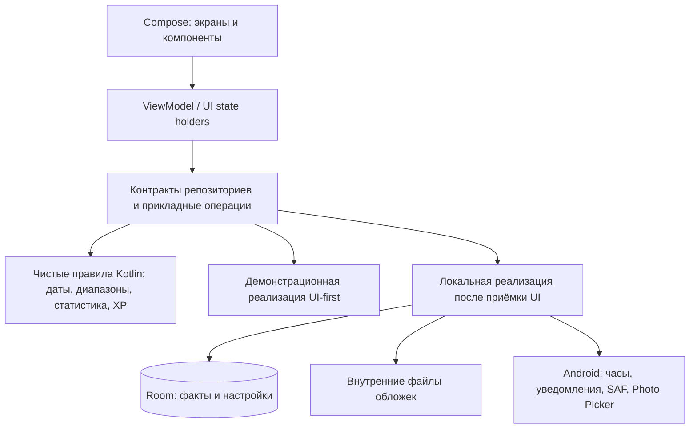
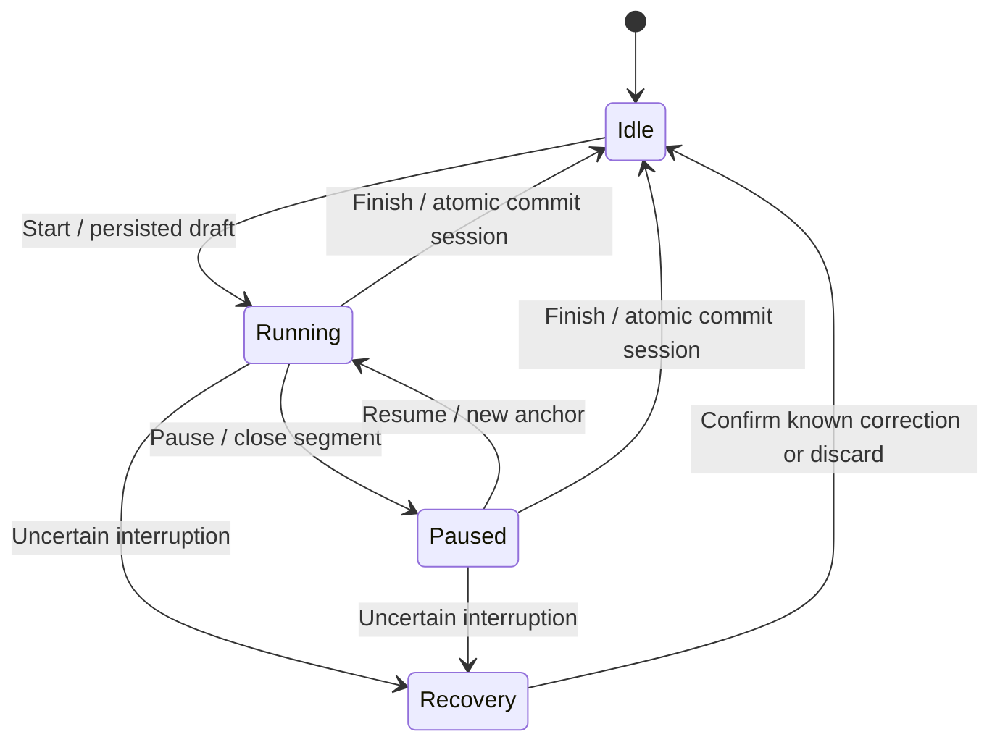
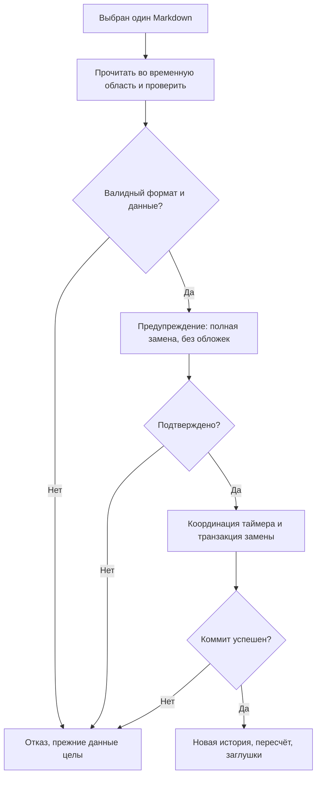

# ARCHITECTURE — Читательский дневник

> Публичная редакция MIGRATION-01 от 13 ноября 2026 г.: обновлены структура источников и контроль целостности; действующий продуктовый договор не изменён. Текущий статус реализации — в README.md.

**Редакция:** 1.1 — архитектурная направленность и TZ-01 утверждены владельцем.
**Дата:** 12 ноября 2026 г.
**Продуктовый контракт:** утверждённые `PRD.md` v1.1, спецификация v2.04, итоговый аудит и каталог А3.
**Статус:** проектирование; код, БД, репозиторий и тестовые сборки ещё не созданы. Документ не разрешает запуск Codex или начало UI-01.

## 0. Как применять документ

PRD определяет **что** делает продукт; этот документ определяет **как** предлагается его организовать. При расхождении остановить затронутую задачу и сверить PRD/актуальную v2.04; не выбирать новую продуктовую трактовку самостоятельно. У1–У8 и А1–А4 имеют приоритет над историческим реестром и устаревшими функциональными примерами дорожной карты v2.0. Последовательность и gates дорожной карты неизменны. Точные визуальные параметры принадлежат будущему UI_DESIGN_SPEC, а не архитектуре.

Обозначения: **Требование** — уже утверждено; **решение архитектуры** — предлагаемый технический выбор для утверждения этим документом; **открыто** — отдельное согласование или проверка осуществимости. Никакая предлагаемая схема не означает готовую реализацию. Имена классов и таблиц логические; физические имена допустимо уточнить в соответствующем PR без изменения контрактов.

## 1. Архитектурная стратегия

### 1.1. Цели и ограничения

- Один личный офлайн Android-клиент Kotlin + Jetpack Compose, без регистрации, серверов, синхронизации, встроенной читалки, телеметрии и обязательного интернета (SCOPE, NFR-01/07).
- Минимальная сложность инфраструктуры: один Gradle-модуль `:app` на старте, логические границы пакетов; не внедрять микросервисы, многомодульность ради модульности, event sourcing всей библиотеки, DI-фреймворк или внешние графические библиотеки без основания.
- Разделение UI от источников данных и расчётов; UI-first с теми же контрактами, которые позднее реализуют настоящие репозитории. Не строить полноценную БД/таймер в UI-01.
- Подтверждённые факты — источник истины, метрики — производные. Локальная надёжность и воспроизводимый пересчёт важнее преждевременной оптимизации.
- Не воссоздавать отменённые функции: секретные/периодические награды, пропущенные диапазоны, историю перерывов цикла, богатый редактор, точные часы ручных сеансов, дополнительные графики, копирование обложек.

### 1.2. Слои и направление зависимостей (ADR-01, проект)

Это схема зависимостей/делегирования, не план параллельной реализации. `domain` не импортирует Compose, Room, Android Context; DTO хранения не передаются в composable. Репозитории и прикладной слой координируют транзакции; чистые калькуляторы не выполняют запись в БД. Android-зависимые адаптеры находятся в data/platform. Не создавать отдельный use case на каждый getter: выделять операции с реальными правилами (завершение, изменение истории, восстановление, пересчёт).

| Логический пакет | Ответственность | Когда появляется |
|---|---|---|
| `app` | Activity, корневая навигация, composition root | UI-01 |
| `ui.designsystem` | Тема, токены, компоненты, semantics, Preview | UI-01 |
| `ui.home`, `ui.library` | Экранные модели и события, маршруты, composable | UI-02 и UI-03 соответственно |
| `ui.book`, `ui.records`, `ui.achievements`, `ui.settings` | Остальные экранные контракты | Отдельные UI-задачи |
| `domain.model`, `domain.rules` | Значимые типы, инварианты, чистые расчёты | Минимум для UI-контрактов; полная логика после UI |
| `domain.port` / `application` | Репозитории, координация сложных команд и чтения снимков | Контракты постепенно; реализация после UI |
| `data.local`, `data.repository` | Room, DAO, маппинг, транзакции | Функциональная стадия |
| `platform.time`, `platform.notification`, `platform.files` | Android API и файловые адаптеры | Только по задачам функциональности; допустимо отдельное исследование осуществимости |
| `demo` / test fixtures | Синтетические состояния, временные взаимодействия | UI-first; не включать тестовые книги в реальную БД |

Composition root передаёт зависимости через конструкторы. На старте достаточно ручного DI (`AppContainer` или аналог). При росте проекта необходимость Hilt/дополнительных модулей обосновать ADR; не добавлять на всякий случай. Использовать coroutines, Flow и неизменяемые состояния, не создавать глобальные mutable singleton-списки книг.

## 2. Платформа и технический стек (ADR-02, проект)

| Область | Предлагаемый выбор | Ограничение |
|---|---|---|
| UI | Kotlin, Compose, Material 3 как техническая основа, собственная тема | Не копировать стандартные цвета/формы Material вместо согласованного дизайна |
| Навигация | Одна Activity, стабильная совместимая версия Jetpack Navigation для Compose | Поддержать все маршруты и правила возврата; версию подтвердить на UI-01 |
| Состояние | ViewModel, StateFlow, lifecycle-aware collection; SavedStateHandle для ограниченного UI-контекста | Не хранить книгу целиком, картинки, историю или таймер только в saved state |
| База | Room/SQLite, внешние ключи, миграции; KSP, если совместим | БД не создаётся на UI-01; никакого destructive fallback для пользовательских данных |
| Настройки | В той же Room БД для всех резервируемых и согласованных настроек | Не использовать отдельный DataStore как второй независимый источник важных данных |
| Время | `java.time` (Instant, LocalDate, YearMonth, ZoneId), Android monotonic clock | Не использовать LocalDateTime как единственный абсолютный момент |
| Файлы | Photo Picker, внутреннее хранилище обложек, SAF для Markdown | Без broad storage permissions, без сетевых запросов |
| Сериализация | `kotlinx.serialization` либо эквивалентный строгий JSON codec для машинного блока внутри Markdown | Схема формата не совпадает со схемой Room; см. §10 |
| Тесты | JVM для чистых правил, Android instrumented для Room/Compose/системных сценариев, скриншоты | Версии и runners в TEST_PLAN/UI-01 |

**Предложение по совместимости:** minSdk 26 (Android 8) как разумная техническая исходная граница для java.time и простоты; это не ранее утверждённая поддержка устройств. Уточнить на UI-01 после сверки актуальных стабильных версий AGP/Gradle/Kotlin/Compose/Room, JDK и требований зависимостей. Если выбранная библиотека требует больше, согласовать фактический minSdk до приёмки каркаса. compileSdk/targetSdk — совместимый стабильный SDK на момент задачи, подтвердить поведением на фактической версии ОС A55. Не привязываться к непроверенному номеру Android и не снижать targetSdk для обхода ограничений. Использовать version catalog, Gradle wrapper и фиксированные совместимые версии, без `+`; доступность SDK в CI проверить. Не объявлять поддержку всех устройств только на основании сборки. Текущий продукт ориентирован на A55, без Google Play/RuStore.

## 3. Контракты UI и навигация (NAV-01–12, NFR-03/04/06)

- Экранный route-компонент собирает `UiState`, чистый screen-компонент принимает данные и callbacks. Компоненты дизайн-системы не имеют ViewModel и не знают о репозиториях. Preview строится на fixtures, без БД и системных сервисов.
- Контракт состояния различает загрузку/пусто/готово/ошибку и независимые признаки действия в процессе, подтверждения и ошибки валидации. Для количественных показателей: известное значение (включая доказанный ноль), подтверждённый минимум + причина неполноты, неизвестно/неприменимо; не превращать `null` в 0.
- Действия пользователя (select, start, save, delete, retry, confirm) идут через экранный state holder к порту. Состояние отображает результат операции, не запускает побочный эффект повторно при recomposition. Навигация по явным действиям или устойчиво обработанному результату. Повторное нажатие не создаёт дубль.
- В UI-first демо-адаптер возвращает детерминированные состояния, поддерживает только локальные визуальные взаимодействия. Например, фильтрация fixture-книг и смена аккордеона допустимы, настоящие измерения времени/XP и реальные операции записи — нет. В debug UI визуальные данные явно обозначены демонстрационными; нельзя выдавать APK за готовый дневник.
- Стабильные ID экранов/книг/циклов, навигационные аргументы только ID, детали загружаются из источника состояния. Не использовать название книги как ключ.

| Экранный контракт | Существенные данные и действия |
|---|---|
| Home | Все читаемые книги с pin-порядком, визуальный таймер, глобальный уровень/XP, 3 метрики, 5 секций, период, выбранная раскрытая секция |
| Library | Сетка/список, запрос, теги/статусы, сортировка, независимый ручной порядок, карточки и предупреждение pending |
| Book | bookId, visitId, выбранная вкладка и цикл просмотра, шапка, bookmark/max/coverage, таймер, история, статистика, записи |
| Session editor | Книга/цикл, тип записи, дата/точность, время при наличии, единый диапазон/статус страниц, разбивка А1 если применима, подтверждение правок |
| Note editor | bookId, при отзыве cycleId, тип, простой текст/страница/оценка в допустимых формах, dirty-state и явное сохранение |
| Achievements | Глобальные XP/уровень, 4 источника, 3 карточки×5 ступеней, собственные карточки, bottom sheets |
| Settings | Тема, зона и возможность изменения, теги, ручной экспорт/восстановление; другие утверждённые настройки |

**Навигационный контракт:** три корневые вкладки «Главная», «Библиотека», «Достижения», настройки сверху. Книга открывается на «Чтение» сверху с развёрнутой шапкой при каждом новом посещении из библиотеки. Временные позиции трёх вкладок и текущий выбранный цикл просмотра сохраняются внутри одного посещения, включая возврат из дочерних экранов, поворот, фон и обычное пересоздание. Восстанавливать по стабильному ID элемента и разумному offset, а не абсолютным пикселям после смены размера. При выходе завершить visit; следующий вход не наследует прокрутку. Новый холодный запуск с иконки открывает Главную, обычное восстановление существующей Activity не является новым посещением. Вход из действующего уведомления — книга/Чтение с панелью таймера, если запись устарела — Главная; Back возвращает к прежнему реальному экрану, при отсутствии — к Главной, без дублей. Таймер независим от back stack. При удалении книги/восстановлении библиотеки проверить актуальность ID и безопасно выйти из недоступных экранов.

**Настройки против временного состояния:** в БД сохраняются утверждённые режимы темы, сетки/списка, сортировки и других настроек, порядок книг/pin, выбранная секция аккордеона. Временная прокрутка, открытый bottom sheet, черновой фильтр/редактор живут в UI и не экспортируются как пользовательская история. Не добавлять автосохранение заметок или постоянное восстановление посещения. В `SavedStateHandle` только небольшие допустимые UI-значения. Точный состав сохраняемых настроек сверить с PRD при разработке соответствующего экрана.

## 4. Хранилище и модель данных (ADR-03, проект)

Предлагается одна транзакционная Room БД. История — нормализованные изменяемые записи, не неизменяемый event log с replay всех действий. ID — непрозрачные UUID, генерируются один раз и сохраняются в Markdown; ссылки не зависят от путей телефона. Даты точного события — типизированные `Instant` и/или календарный ключ `LocalDate`, в соответствии с семантикой. Секунды/XP — Long, номера страниц — проверяемые целые. Порядок циклов — стабильный ordinal/id, не выводить из неточных дат. БД содержит только факты и необходимые служебные данные; вычисляемые представления можно кешировать как производные.

### 4.1. Логическая схема таблиц

| Сущность | Основные поля (логические) | Инварианты |
|---|---|---|
| Book | id, title, author, pageCount, addedAt, format, publisher/year/translator/ISBN/edition?, coverKey?, libraryRank, pinnedRank? | Совпадения title/author допустимы; положительный объём; coverKey только локальный |
| Tag | id, name, normalizedKey | Уникальность по нормализованному имени; удаление не удаляет книгу |
| BookTag | bookId, tagId | составной ключ, внешние ключи |
| ReadingCycle | id, bookId, ordinal, status, startDateValue, endDateValue, historical flag/origin, bookmark, reachedMax, bookmarkRevision, approxSeconds?, rating? | ≤1 незавершённого на книгу; 0≤bookmark≤max≤pageCount, rating 1–10 или null; историческое время только справочно |
| CompletionFact | cycleId (уник.), confirmedAt?, confirmedDate, active | Только действительное завершение текущего цикла; исторические — без факта бонуса; дата А2 неизменна при правке endDate |
| ReadingSession | id, cycleId, origin TIMER/MANUAL, date для ручной, timing provenance, activeSeconds, start/end Instant? для точного таймера, pageStatus, rangeStart/end?, bookmarkChangeRevision? | Ручная дата без часов, таймерная достоверность; один диапазон либо pending/unknown; точные интервалы не перекрываются |
| ActiveSegment | sessionId, sequence, startInstant, endInstant, measuredDuration | Только подтверждённые активные отрезки точного таймера; паузы не входят, интервалы полуоткрытые; не для ручного времени |
| SessionDay | sessionId, localDate, activeSeconds, pageCount? | Сумма времени равна сеансу; число страниц только при полной проверенной разбивке А1, без выводов об идентичности страниц |
| PageOnlyEvent | id, cycleId, dateValue, rangeStart, rangeEnd, bookmarkChangeRevision? | Один достоверный диапазон; времени нет, не 0 секунд измеренного времени |
| BookNote | id, bookId, kind NOTE/QUOTE, text, page?, createdAt, updatedAt | Книга, не цикл; простой текст; необязательная страница |
| CycleReview | cycleId (уник.), text, createdAt, updatedAt | ≤1 отзыв на цикл, рейтинг хранится только один раз в цикле |
| CustomAchievement | id, name, conditionText, xpNominal, iconKey?, accentKey?, deleted flag | 0–600; при удалении скрыть карточку, сохранять минимальное происхождение действующего факта |
| CustomAward | id, achievementId, actualXp, confirmedAt?, confirmedDate, revoked | Не более одной действующей выдачи на achievementId; отмена адресная; изменение номинала не меняет сумму |
| JournalSettings | singleton id, zoneId, zoneLocked, theme, display/sort/period/accordion prefs… | Один пояс; настройки из резервной копии восстанавливаются вместе с фактами |
| TimerDraft | singleton slot, draftId, cycleId, status, anchors, confirmedSegments, checkpoints, boot identity, revision | Одна глобальная запись RUNNING/PAUSED/RECOVERY; не является уже сохранённым сеансом |

`ActiveSegment` может быть отдельной таблицей и для черновика; физическую схему выбирать без потери соответствующих полей. `SessionDay` — проверяемая нормализованная детализация: для точных сеансов согласована с измеренными отрезками и календарными границами; для ручного — одна дата и длительность. Факты А1 (количества страниц) не пересоздаются из длительности. При изменении времени пересчитать дневные секунды и повторно валидировать разбивку страниц. Если правка делает разбивку недостоверной, предложить исправить/явно снять разбивку, не уничтожать её молча. Исправленный таймер, которому уже невозможно приписать точные интервалы, не притворяется точным: при подтверждении использовать семантику ручной записи с достоверными датой и длительностью, сохранять происхождение коррекции; при нескольких датах — отдельные подтверждённые записи, без двойного учёта. Конкретный сценарий исправления согласовать с PRD TIME-01/03/09/15.

Встроенные определения А3 — константы домена со стабильными ID; ступени и глобальный XP — детерминированные проекции. Не хранить независимый редактируемый баланс. При необходимости материализовать `BuiltInAwardProjection(catalogId, stage, earnedDate, xp)` с уникальным ключом и пересчётом из фактов в той же транзакции; не импортировать кеш как бесспорный источник. Бонус +100 вычисляется из активного `CompletionFact`, собственные награды — из `CustomAward`. Храним факты, а не отдельное увеличение счётчика при каждом открытии экрана.

**Статус книги:** единая согласованная модель: отображаемый статус определяется текущим (если есть) или последним завершённым циклом; книга «Хочу прочитать» может иметь запланированный незавершённый цикл с нулевыми/введёнными данными. Не вести две независимо редактируемые копии статуса. Если на стадии моделирования обнаружится не покрытый PRD переход (например, ручная отмена завершения прежнего цикла при уже существующем незавершённом), показать конфликт и разрешить только согласованное исправление, не создавать второй незавершённый цикл.

### 4.2. Тип точности даты

Не хранить приблизительную дату как первое число месяца или 1 января. Tagged union: DAY(LocalDate), MONTH(YearMonth), YEAR(Int), UNKNOWN. Инвариант единственного варианта, валидные календарные значения. DateValue — гражданская дата события, не обязательно Instant; `addedAt` и `confirmedAt` имеют отдельную семантику. Преобразование точности никогда не создаёт фиктивную историю. Для сортировки неточных событий использовать группы «День неизвестен»/«Месяц неизвестен»/«Дата неизвестна»; стабильный технический порядок не выдавать за хронологию.

### 4.3. Индексы и ограничения

Внешние ключи и индексы на bookId/cycleId/sessionId/tagId, SessionDay.localDate, даты подтверждения наград, связи заметок и отзывов; уникальные cycle ordinal, normalized tag key, award pair и один singleton slot. Ограничения диапазона/дневных сумм, непересечения, один незавершённый цикл и совместимость дат проверять транзакционными командами, а где допустимо — CHECK/UNIQUE/триггеры или эквивалентные ограничения SQLite. Не полагаться только на форму. Частичные unique-индексы при необходимости оформлять проверяемыми миграциями, не считать их автоматически поддержанными аннотациями Room. Защиту от гонок доказать instrumented тестом. Для поиска небольшой личной библиотеки начать с простого локального нормализованного поиска; SQLite NOCASE не обеспечивает полноценный регистронезависимый поиск кириллицы, применять проверенную Unicode-нормализацию и Locale.ROOT в Kotlin, проверять русские строки. Не вводить FTS/ранжирование без необходимости.

## 5. Команды, транзакции и целостность

Все операции изменения фактов проходят один слой команд. Для связанных изменений — Room transaction; перед подтверждением рассчитать план и зависимые последствия, после подтверждения заново проверить актуальные версии/состояние в транзакции. Ошибка не фиксирует частичное изменение. Прямые UI-вызовы DAO запрещены. Использовать стабильные command/session ID и уникальные ключи для повторных попыток; при необходимости сериализовать запись/экспорт/импорт в application coordinator. Не выполнять файловый I/O внутри долгой транзакции БД, кроме необходимых локальных коротких операций; разделять подготовку и коммит.

| Команда | Атомарные изменения и гарантии |
|---|---|
| AddBook/EditBook | Поля и связи тегов, начальный цикл/закладка; стартовая страница не создаёт диапазон. Новая обложка подготовлена до коммита. |
| ChangePageCount | Мастер выявляет все зависимые данные всех циклов, заметок/цитат; план явно подтверждённых исправлений; повторная валидация; единый commit, без автоматического обрезания. |
| MoveBookmark | Обновляет bookmark, максимум/ревизию по правилам; не создаёт страницу/время/XP. |
| CreateReread/Defer/Resume | Только разрешённые переходы, таймер предварительно урегулирован; один незавершённый цикл, старые данные сохранены. |
| CompleteCycle | Явная команда, проверка незавершённых сеансов/таймера и конфликтов; статус, даты, единственный CompletionFact; +100 определяется фактом. Последняя страница сама ничего не завершает. |
| RevokeCompletion | Отмена действительного факта, пересчёт; не допустить второй незавершённый цикл. Повторное действительное завершение создаёт одну актуальную дату подтверждения. |
| Save/Edit/DeleteSession | Проверить принадлежность, допустимые дату/длительность/диапазон, А1, дневную сумму и точные конфликты; заменить исходный факт, пересчитать производные; не прибавлять повторно. |
| Save/Edit/DeletePageEvent | Один диапазон, DateValue; только по явному флагу меняется закладка; правка/удаление не угадывает прежнюю позицию. |
| SaveNote/Quote/Review/Rating | Сохранение вручную, проверка принадлежности и страницы, отдельный отзыв/оценка на цикл. Таймер продолжает работу. |
| Claim/RevokeCustomAward | Единственный активный факт, сумма на момент выдачи и дата; повторный запрос идемпотентен; адресная отмена исключает фактический XP. |
| DeleteCustomAchievement | Скрытие карточки и сохранение законного факта; не стирать исторический XP, минимальная запись происхождения остаётся. |
| DeleteBook | Сначала согласовать таймер/ожидающие записи; после подтверждения удалить связанные факты, теги-связи, циклы/заметки и связанные бонусы; собственные независимые награды не удалять. Пересчитать. |
| Restore | Предварительно проверить весь файл; затем полная замена всех резервируемых фактов и настроек в одной транзакции, сброс производных кешей. См. §10. |

Подтверждения хранят не mutable DTO, а идентификатор/версию плана; если данные успели измениться, потребовать новую проверку. Прогресс/XP/серии/рекорды считывать из одного согласованного снимка. На небольшой библиотеке начать с полного чистого пересчёта затронутых проекций после операций (не на каждом тике таймера). Измерить масштабирование на fixtures; только затем оптимизировать инкрементально, сравнивая с эталонным полным пересчётом. Ошибка вычисления не приводит к фиксации противоречивых производных; при кешировании использовать revision и атомарную публикацию.

## 6. Таймер и Android-жизненный цикл (Т1, Т3, Т6; TIME-01–17; ADR-04)

### 6.1. Принцип измерения

Длительность измерять монотонными часами `SystemClock.elapsedRealtime` (включают deep sleep), календарные моменты — wall clock/Instant. Не считать число coroutine ticks, не использовать `uptimeMillis` или разность wall clock для активного времени. Хранить опорную пару monotonic + wall Instant на старте/продолжении, подтверждённые закрытые отрезки и состояние. Технический расчёт в миллисекундах до канонического преобразования в целые секунды: не округлять по каждому тику, паузе или полуночи; определить единое квантование суммарного времени сеанса и распределить целые секунды по хронологическим границам без потерь внутри сеанса. XP округляется только после глобального суммирования целых секунд (PRD). Не считать время на паузе. Wall-clock jump обнаруживать сопоставлением опорных часов; если календарная привязка становится недостоверной, не приписывать произвольные дни, предложить коррекцию. Смена зоны телефона сама не меняет дневниковую зону.

### 6.2. Состояния и переходы

Ожидание страниц — **состояние сохранённого сеанса**, не состояние глобального таймера. После Finish в одной транзакции закрыть активный отрезок, сохранить время/SessionDay и новый sessionId с PENDING, удалить draft. Далее редактор диапазона: CONFIRMED, «Позже» (PENDING) или UNKNOWN_EXPLICIT («Не помню страницы»). PENDING блокирует следующий таймер только этой книги, в том числе при просмотре другого цикла; UNKNOWN_EXPLICIT снимает блокировку и позволяет уточнить позже. Сеансы другой книги доступны после освобождения глобального slot. Не начислять XP за один и тот же draft и сохранённый session. Время сохранённого PENDING учитывается сразу; страницы и скорость остаются неполными. Тик UI отражает незавершённое время, но не начисляет постоянный XP.

Start/Pause/Resume/Finish — сериализованные команды с проверкой slot и revision. Start не допускает второй действующий/приостановленный/неурегулированный draft. При повторном Finish вернуть существующий sessionId, не создать второй. Точные таймерные внешние интервалы проверять на ненулевое пересечение с другими точными сеансами, общая граница допустима; не требовать точного сравнения с ручными записями без часов. Ручной ввод и таймерная коррекция проверяют дневной максимум по **реальной** длине каждого дня (23/24/25 часов и иные изменения зоны); учитывать уже подтверждённые данные и известную активность draft там, где это достоверно. При конфликте не обрезать сеанс и не терять факты: показать ошибку и предложить согласованную коррекцию. Предупредить о возможном двойном учёте ручных записей; не утверждать, что пересечения доказанно отсутствуют.

### 6.3. Сохранение и восстановление

Черновик и закрытые отрезки сохраняются при пользовательских переходах, при необходимости контрольные точки — не для измерения каждой секунды, а для безопасного восстановления. UI после обычной блокировки/фона вычисляет отображение от опоры. Монотонные значения относятся только к тому же boot; проверяемая идентичность загрузки устройства и достоверность anchor — техническое исследование. Не сравнивать elapsedRealtime между перезагрузками. Завершение процесса не обязано вызывать callback; force-stop и пользовательский Stop — не обычный фон. При неопределённости не восстанавливать предполагаемый интервал до текущих часов. Показать факт прерывания, сохранить законные завершённые данные, предложить ручное подтверждение достоверной даты/длительности либо отказаться от незавершённого draft; не подменять уже измеренное время выдуманным, не дублировать известные части. Сохранённая пауза не создаёт активность. После импорта не возобновлять чужой monotonic anchor.

### 6.4. Уведомление и foreground service

**Требование:** один простой notification действующего таймера, включая паузу, без кнопок управления; tap открывает книгу/Чтение; никаких системных уведомлений о страницах. Кандидат — foreground service, запускаемый из видимого приложения по Start, с подходящим разрешённым типом для актуального targetSdk; `specialUse` рассматривать только если удовлетворяет правилам платформы и не существует более точного применимого типа. Не использовать `mediaPlayback`, `dataSync`, location или systemExempted для обхода. Не делать FGS обязательным источником длительности; время вычисляется из фактов/монотонных опор. Проверить ограничения старта из фона, сроки запуска foreground, поведение паузы/Finish, отклонённый `POST_NOTIFICATIONS` (на Android 13+ пользователь может не видеть notification в шторке, даже при допустимом FGS), остановку через Task Manager и OEM One UI. Не запрашивать точные будильники, постоянный wake lock, исключение из оптимизации батареи или boot-autostart без доказанной необходимости. Не обещать доступность кнопки/уведомления при отказе разрешения. При отказе/недоступности обеспечить честное сообщение и безопасный учёт, а не фиктивный результат.

**Gate T6:** до настоящей реализации выбрать техническую стратегию на базе официальных правил Android и проверить в отдельном разрешённом небольшом задании на A55: экран выключен, длительный фон, pause/resume, уничтожение процесса, reboot, force-stop, отсутствие уведомлений. Исследование допустимо до бизнес-логики лишь без изменения утверждённого UI и с отдельным разрешением. Пока нет эксперимента, выбор FGS и надёжность после OEM-ограничений не считаются доказанными.

## 7. Календарная модель и закрепление зоны (Т2–Т3, ADR-05)

### 7.1. Действующие правила

Первый запуск один раз получает именованный ZoneId телефона. Не синхронизировать автоматически позже. До первого сохранённого факта с конкретной календарной датой учёта пользователь может менять предварительную зону вне действующего таймера; затем закрепление навсегда для этой истории (TZ-01). Импорт полной копии восстанавливает зону/lock. Если зона недоступна, не выбирать произвольно. Никаких обязательных диалогов при первом чтении. Day boundary вычисляется через начало локальной даты и начало следующей даты в ZoneId, не `+24h`. Исторические/ручные гражданские даты не переводить как Instant. Хранить применённые календарные ключи подтверждённой истории, чтобы обновление tzdb не меняло её молча; если пересчёт по обновившимся правилам выявляет несовместимость, показать проблему, не перезаписывать старые факты без согласования. Точные timestamp/длительности сохраняются. Для подсчёта дневной длины учитывать реальные правила зоны.

### 7.2. Утверждённое уточнение TZ-01

**Уточнение TZ-01 (утверждено 12 ноября 2026 г.; актуализирует №243):** именованный часовой пояс дневника необратимо закрепляется при первом успешно сохранённом факте, привязанном к конкретной календарной дате учёта: таймерный или ручной сеанс, точно датированное событие «Читал без таймера», точнодатированный факт действительного завершения цикла или личной награды. Простое добавление книги/тега, техническая дата заметки, просмотр экрана и приблизительная дата сами по себе не закрепляют зону. При активном или приостановленном таймере смена зоны временно недоступна. После закрепления удаление записей не разблокирует настройку; полное восстановление заменяет зону и состояние блокировки данными копии. До закрепления и вне действующего таймера зону можно изменить вручную. Никакого переноса истории при системной смене зоны.

При сохранении первого квалифицирующего факта закрепление должно быть транзакционным с записью факта. Проверить отказ сохранения, приблизительную дату, удаление последней записи и полное восстановление. Не считать технические даты создания/изменения обычных объектов датой учёта.

### 7.3. Разделение активного времени и дат

Для каждого достоверного активного отрезка пересечь полуоткрытый интервал [start,end) с фактическими календарными границами в зоне дневника, вычислить длительность каждой части. Пауза на границе не создаёт активной даты. Дни с нулём активного времени не являются датами А1. День, неделя, месяц, год и выбранный период определяются общими calendar functions. Сегодня и скользящие 7/30/90 дней используют календарные даты, а не 24-часовые окна; трактовка «Год» и группировки недели сверяется с PRD/дизайн-спецификацией, не подменять её произвольно. Для пользовательского интерфейса и календаря вводить Clock/ZoneProvider, чтобы тестировать переходы через полночь без ожидания реального времени.

## 8. Страницы, статистика и вычисляемые проекции (Т2, Т5; PAGE, ANALYTICS, BOOKSTAT; ADR-06)

### 8.1. Независимые измерения прогресса

Различать bookmark (позиция), reachedMax (рубеж), total read (объём), unique read (множество страниц). При добавлении книги на странице 180: bookmark=max=180, доказанных диапазонов нет. При чтении 1–10 и 6–15: объём 20, уникальных 15, а текущая позиция определяется подтверждённым действием. Для уникального объёма отсортировать диапазоны по началу и объединить пересекающиеся/соприкасающиеся интервалы в рамках цикла; не выделять массив размера всей книги. Карта выводится из объединения, не из независимых флагов UI. Максимум хранится как явно достигнутый рубеж и согласуется с закладкой/доказанными страницами; при правках истории нельзя автоматически откатывать его до длины объединения. PAGE-01–11 и TIME-21/22 определяют допустимые предложения изменения. Ревизия закладки позволяет доказать, что после события не было самостоятельного перемещения. В агрегате нескольких циклов различать общий объём перечитываний и уникальность в пределах конкретного цикла; если нужен показатель уникальности по книге, объединять диапазоны по той же записи/изданию, явно не путать с суммой уникальных страниц циклов. Точное определение метрики берётся из PRD, не добавлять новую статистику без согласования.

### 8.2. Календарный подсчёт количества страниц (А1)

У подтверждённого диапазона длина `end-start+1`. Для сессии с одной активной датой объём относится к ней; для нескольких дат — только добровольная полная разбивка с суммой, равной длине. Разбивка оперирует количеством, не идентичностью страниц. Для периода алгоритм выбирает один путь:

1. Если дневное распределение подтверждено, суммировать только относящиеся к периоду количества (не добавлять общий диапазон ещё раз).
2. Если не подтверждено и период охватывает все активные даты, добавить длину диапазона ровно один раз.
3. Если пересечение частичное, не добавлять произвольную долю; пометить объём неполным/неизвестным, показать подтверждённый минимум и ссылку на исходную запись. Если период не пересекается, не добавлять этот объём.
4. Если сам диапазон неизвестен/pending, записанное время учитывается, страницы — нет, отчёт помечается неполным в относящихся датах.
5. Для PageOnlyEvent использовать точность DateValue: день допускает day/week/month; месяц — только охватывающий месяц/более крупный период; год — охватывающий год; UNKNOWN — все время. Если выбранное окно охватывает лишь часть известного месяца/года, не выдавать весь диапазон за относящийся к нему. Отдельный маркер неточной даты независим от маркера неполного количества. Не считать границу диапазона доказательством распределения уникальных страниц по дням.

Состав агрегата: `knownAmount`, `unknownQuantityCount`, `unallocatedCount`, `datePrecisionFlags`, источники/ID для перехода к уточнению. Если есть подтверждённый минимум и неполнота — `≥N`; если нет подтверждённых страниц при наличии неизвестного — «Страницы неизвестны», не столбец высоты 0. Для истории с неполной датой отдельные группы согласно TIME-17/ANALYTICS-11. Частичный период не должен искусственно увеличивать дневные рекорды. При повторных событиях считать фактический объём, не дедуплицировать намеренное чтение одинаковых страниц; защита от технических дублей команд отдельна.

### 8.3. Общие чистые калькуляторы

| Проекция | Источники и правило |
|---|---|
| DailyActivity | SessionDay: записанные секунды; page breakdown и PageOnlyEvent; метки неполноты; ссылки на книги/сеансы |
| PeriodStats | Сумма дневного времени, число фактов по правилам выбранного периода, страницы по §8.2, завершения по точности даты самого прочтения, охват данных |
| Heatmap | Годовая сетка, заливка по записанному времени (ориентиры PRD), маркер ≥300 сек, отдельный маркер чтения без времени при точной дате; детализация по книгам |
| ReadingStreak | Непрерывные даты с ≥300 сек; лучший исторический максимум; текущая серия учитывает текущий календарный день и истечение дня, а не фиксированный интервал 24 ч |
| BookComparison | Все книги «Читаю», включая нулевые по записанному времени; горизонтальные столбцы по времени, порядок убывания |
| Speed | Только сопоставимые пары: достоверные страницы / соответствующие положительные активные секунды × 3600; не среднее индивидуальных скоростей; нет данных — неизвестно |
| Forecast | Только текущий активный цикл, оставшиеся страницы / положительная средняя скорость; прогноз часов, не даты, приблизительно; отсутствие данных — «—» |
| Records | Шесть карточек У6; лучший день по времени/страницам, длиннейший сеанс, лучший месяц по времени, длиннейшая серия, книга с максимумом времени; по страницам явно среди полных данных |
| BookStats/CycleStats | Тот же calculator с фильтром bookId/cycleId; простой список итогов прочтений; различить уникальные книги и циклы |

При фильтре скорости по календарному периоду брать только пары времени и страниц, которые достоверно сопоставлены: полный охват сеанса или подтверждённая дневная разбивка вместе с его временем; не делить все страницы на часть времени. Нулевой известный объём и неизвестный объём различаются. Для прогноза кандидат — оставшиеся страницы до конца по достигнутому рубежу; это оценка достижения конца, не обещание уникального покрытия. Проверить точную трактовку в PRD и не считать пропуски прочитанными. Если выбранный цикл завершён, прогноз не показывать. Сценарии пустой истории, первого сеанса, нулевого количества и неполноты покрыть тестами.

На первом функциональном этапе использовать чистые функции и вычисления вне main thread на одном снимке данных. При необходимости добавить кеши с revision. Не вводить пользовательские настройки перестановки блоков, радар, месячный календарь, график сравнения периодов, тренд скорости и расширенные рейтинги. Данные для пяти секций Главной и длинной страницы статистики книги формируются из общих калькуляторов, а не дублируются в UI.

## 9. XP, уровни, достижения (Т2, Т5; XP-01–33; ADR-07)

### 9.1. Единый баланс и даты

- XP_time = floor(sum(достоверных активных секунд за всю историю)/60), включая подтверждённые ручные и pending-страницы; исключить паузы, неизвестное и приблизительное время.
- XP_completion = 100 × число активных законных CompletionFact; дата А2 — дата фактического подтверждения. Не применять дату начисления к статистике фактических прочтений. Исторические завершения без бонуса.
- XP_builtin = сумма всех доказанных ступеней А3; ключ catalogId+stage; дата порога вычисляется по событиям, не по запуску пересчёта.
- XP_custom = сумма actualXp всех неотменённых однократных ручных наград, включая удалённые карточки; номинал не подменяет actualXp.
- totalXP = сумма четырёх источников. Никакого отдельного баланса или расходования XP. Запрещены накопительные `balance += ...` при каждом открытии/пересчёте.

**Кандидат технического решения Т2:** сортировать фактические календарные даты; `S_before(d)` — сумма секунд до даты d, `S_through(d)` — включая d. Дневной XP = floor(S_through/60) − floor(S_before/60). Для непрерывного периода [a,b] разность накопленных значений на его концах, для всего времени floor(total/60). Это переносит остаток секунд между днями детерминированно, не назначая его произвольному сеансу. Пример: день 1 — 59 с → 0 XP, день 2 — 59 с → 1 XP; вместе 118 с → 1 XP. Если удалить первый день, день 2 станет 0 XP. Позднее внесение может изменить дневную разбивку, даже если часть секунд относится к более поздней записи; объяснение — округление накопленного времени, не новая награда. Все дневные XP неотрицательны, сумма совпадает с глобальным XP. Предлагается как архитектурный алгоритм без изменения утверждённой ставки. Не назначать XP за время по каждой книге/сеансу независимо, если такое разбиение не согласовано.

### 9.2. Уровни и звания

C(n)=200+50×(n−1); T(L)=25×(L−1)×(L+6). Уровень — максимальный L≥1 с T(L)≤totalXP; остаток внутри уровня — totalXP−T(L). Использовать целочисленный безопасный поиск (или проверенное аналитическое приближение с проверкой границ), защищать переполнение, не округлять float на порогах. 0 XP → 1, 199 → 1, 200 → 2, 450 → 3, 1100 → 5, 3600 → 10, 12350 → 20, 26100 → 30. Звания: Искатель 1, Ученик 5, Исследователь 10, Хранитель знаний 20, Мудрец I 30, далее каждые 10 уровней. Степень k=1+floor((L−30)/10). Звание не начисляет XP; исправление истории может понизить уровень/звание. Отображение высоких степеней без переполнения и обрезания (визуальные правила уточнить в UI_DESIGN_SPEC).

### 9.3. Каталог А3 — неизменяемые данные конфигурации

| ID / название | I +25 | II +50 | III +100 | IV +150 | V +200 |
|---|---:|---:|---:|---:|---:|
| streak / Сила привычки | 3 д. | 7 д. | 14 д. | 30 д. | 100 д. |
| reading_time / Время за книгой | 1 ч | 10 ч | 30 ч | 100 ч | 300 ч |
| completed_cycles / Путь читателя | 1 | 5 | 10 | 25 | 50 |

Время сравнивать в секундах 3600/36000/108000/360000/1080000. Для streak — дата первого достижения длины последовательности, для времени — первая дата, к концу которой накопленные секунды достигли порога, для прочтений — дата факта завершения, достигшего порога; одновременные факты упорядочить стабильно по фактическим моментам/ID, не выдумывать время. Срыв текущей серии не стирает историческую лучшую. При исправлении истории заново вычислить допустимое множество и даты; потерянные пороги отозвать, при повторном достижении восстановить одну действующую ступень. При скачке через несколько порогов начисляются все достигнутые ступени ровно по одной; 525 XP на направление, 1575 максимум каталога. Сравнить до/после в одной операции для обычного ненавязчивого поздравления, не показывать все награды повторно при старте, импорте или пересчёте. Собственные достижения вручную, 0–600, удаление карточки не удаляет начисление; отмена исключает именно фактический XP и позволяет корректную повторную выдачу. Не добавлять редкости, секретность, периоды и автопроверку личных условий.

## 10. Markdown, обложки, восстановление и безопасность (Т4; SCOPE-04–06, NFR-02/07; ADR-08/09)

### 10.1. Хранение обложек

Photo Picker -> preview -> явное подтверждение. Копировать выбранный допустимый файл во внутреннее хранилище приложения под сгенерированным ключом, независимо от URI оригинала; проверить, что изображение декодируется, учитывать память, EXIF и размеры. Не перекодировать оригинал без необходимости, допустим кеш уменьшенного изображения для UI. Сначала подготовить новый файл и проверить его, затем атомарно заменить ссылку в БД; старый удалить только после успешного коммита при отсутствии ссылок. При сбое удалить лишь новые неприкреплённые файлы по безопасной процедуре, отложенная очистка сирот не удаляет действующие обложки. При удалении книги, замене базы и очистке кеша картинки не являются критичными для целостности БД. При отсутствующем файле — заглушка; восстановление У8 намеренно обнуляет все coverKey. Не экспортировать картинки, Base64, абсолютные пути, старые URI. Не копировать локальные обложки из прежней библиотеки в восстановленную даже при совпадении ID.

### 10.2. Предлагаемый формат одного файла

Один UTF-8 `.md`, без пароля/шифрования/ZIP. Читаемый краткий текст и один строго обозначенный машинный блок JSON (не разбор свободного текста). Предлагаемый envelope: format ID `reading-journal-backup`, formatVersion, экспортный ID, createdAt, версия схемы, контрольная сумма SHA-256 **точных UTF-8 байтов payload**, payload; формальное расположение метаданных и рамок блока, каноническое кодирование и пример fixtures — отдельный ADR при функциональной задаче. JSON может хранить пользовательский текст с любыми переносами и Markdown-символами; парсер не должен ошибочно воспринимать текст заметки как конец блока. Контрольная сумма выявляет случайную порчу, не обеспечивает аутентификацию/шифрование. Версия формата независима от Room schemaVersion. Не сохранять необоснованные итоги как истину; экспортировать исходные сущности и факты, дата А2/личные награды, А1, DateValue, settings и lock; при включении производных фактов встроенных наград валидировать их пересчётом. Все пользовательские записи, включая ожидающие страницы/неизвестность, и настройки сохраняются. Технические кеши, временный UI, картинки, разрешения URI, monotonic boot anchors не переносить как достоверные факты. Если в момент экспорта есть действующий timer draft, нельзя молча выдать незавершённое/неизвестное время за законный сеанс; **предлагаемое техническое поведение:** согласовать сохранение подтверждённых частей и перенос отметки о прерывании либо предварительно безопасно завершить/урегулировать draft, без потери уже подтверждённых данных. Если для этого понадобится новое ограничение экспортного UX, согласовать в задаче резервирования; не объявлять экспорт запрещённым по умолчанию без согласования. При импорте незавершённого таймера нельзя автоматически запускать его на новом устройстве.

### 10.3. Экспорт (ручной, SAF)

1. Получить согласованный снимок фактов в read transaction; сформировать и проверить временный файл внутри app storage (ограниченные ресурсы, без секретов в логах).
2. Предложить уникальное имя с датой и ID/суффиксом, вызвать системный выбор места нового документа (`ACTION_CREATE_DOCUMENT`, MIME Markdown/совместимый текстовый); не открывать старую копию для перезаписи. Уважать выбор локального или пользовательского доступного провайдера; приложение само не инициирует облачный экспорт.
3. Записать один файл, закрыть поток, проверить результат и при доступности повторно прочитать/проверить контрольную сумму. Не сообщать «успешно», если поток/провайдер завершился ошибкой или результат не подтверждён. При отмене/ошибке пытаться удалить только новый неполный документ в пределах предоставленных прав; если нельзя — предупредить об остатке. Никаких удалений прежних копий. SAF не гарантирует файловую транзакцию у любого провайдера, поэтому отделять staging и проверку; не обещать атомарность внешней записи.
4. Уведомить о результате и исключении обложек. Никаких периодических задач, автокопий, календарных подсказок, пароля. Не требовать отдельной папки/архива. Не запускать экспорт при открытии экрана. Необязательное действие перед опасным удалением книги сохранено.

### 10.4. Импорт (полная атомарная замена)

- `ACTION_OPEN_DOCUMENT` с одним файлом; сначала прочитать и проверить вне активной БД, ограничить размеры/глубину/количество объектов по обоснованным техническим ресурсам, не вводить произвольный продуктовый лимит. Строгая схема, версия, целостность, отсутствие дублирующих ID, ссылки, enum, числа, даты, диапазоны, один незавершённый цикл, допустимые дневные суммы/точные интервалы, законные награды, соответствие разбивки А1. Не исполнять Markdown, JS, SQL или произвольные пути из файла. Неподдерживаемую версию отклонить с объяснением; совместимые старые форматы только с проверенным преобразованием. Не исправлять значения молча.
- До изменения базы простое явное предупреждение о полной замене и отсутствии обложек, запрос подтверждения. Не делать подробный предпросмотр счётчиков, обязательную страховочную копию, слияние или частичный импорт. Отмена сохраняет текущую историю. Уважать конфликт активного таймера: заранее безопасно урегулировать его в соответствии с TIME и не потерять данные до коммита. Точный сценарий конфликтов активного draft — согласовать в функциональной задаче, если меняет UX.
- Сериализовать изменения; после подтверждения проверить тот же проверенный снимок, не повторно читать изменяемый внешний файл. Одна Room transaction для всех резервируемых таблиц и настроек, включая зону/lock, факты наград и проверяемые проекции; не удалять файлы БД напрямую. Исключить старые обложки из новых ссылок; физически удалить прежние сиротские картинки только после успешного коммита. При ошибке rollback, прежние данные/настройки/обложки доступны. UI публикует новый снимок только после успеха. Не обещать отмену уже успешно совершённой полной замены.
- После commit убрать устаревшее UI-состояние/ссылки, остановить недействительный сервис/уведомление и не запускать перенесённый таймер. Пересчитать статистику и XP из фактов, даты факта награды не менять на импорт. Проверить восстановление при системной зоне, отличной от сохранённой. При сбое после commit согласованность БД не зависит от удаления сиротских файлов или доставки нотификации.

### 10.5. Приватность, миграции, логирование

Офлайн: не добавлять INTERNET и сетевые SDK без явного основания. Никаких аналитических сервисов, crash upload, содержимого заметок/цитат, имён книг, URI или персональной истории в логах/CI. Тестовые данные только синтетические. Файлы и БД в app-private storage. Android Auto Backup может автоматически участвовать в системном резервировании: для соблюдения решения «только вручную» явно отключить cloud backup, исключить пользовательские данные/обложки/настройки из cloud/device-transfer и применимых правил Android, проверить на целевом устройстве; не обещать универсальный запрет поведения OEM только одним `allowBackup=false`. Не шифровать пользовательский Markdown вопреки выбору владельца; рядом с экспортом информировать о доступности текста человеку с файлом. Настоящие копии не коммитить в GitHub.

Room: зафиксировать schema export в Git (без реальных данных), увеличивать schemaVersion при изменениях, явные миграции и migration tests. Не применять fallbackToDestructiveMigration. При ошибке открыть безопасное состояние с сообщением/возможностью корректного восстановления, не стирать библиотеку. Для backup format отдельная матрица читаемых версий и round-trip fixtures. Сохранять стабильные ID enum/награды независимо от локализованных названий. Не менять смысл ранее сохранённого поля без миграции. Параметры signing/applicationId определить до первой долговременной установки, не хранить ключи/пароли в Git; обновление APK должно сохранять данные при совместимых подписи и миграции. Debug и итоговые сборки — с явно обозначенным режимом данных; переход от demo к реальному не импортирует тестовые записи.

## 11. Реализация по утверждённой дорожной карте

| Gate | Архитектурный объём | Не включать |
|---|---|---|
| DOC | PRD утверждён; архитектура, дизайн-токены, план, тесты, AGENTS, README, архив и ADR согласованы | Код, создание репозитория, неподтверждённые изменения требований |
| REPO | Только отдельно разрешённый приватный GitHub, docs-only commit; проверить приватность/историю | Реализацию UI-01, merge без разрешения |
| UI-01 | Один собираемый :app, базовые зависимости, themes/components, корневой каркас, Preview, демонстрационные маршруты | Полноценные Home/Library, БД, реальный таймер, XP, резервирование |
| UI-02 | Home, state/event contract, mock fixtures, проверки всех состояний, APK A55 | Library и реальная аналитика/таймер/XP |
| UI-03 | Library, grid/list, demo filters/sort/drag interactions, состояния, APK обе темы | БД и реальные CRUD, другие полноценные экраны |
| Другие UI | Малые отдельные задания, mock contracts, эталон UI-01–03 | Подключение бизнес-логики до общей визуальной приёмки |
| Функциональность | Локальный storage/модели, CRUD/циклы, таймер/сеансы/страницы, вычисления, записи, XP, backup; последовательность детализируется в IMPLEMENTATION_PLAN | Массовая переделка утверждённой визуальной системы, отменённые функции |
| PERSONAL-READY | Интеграция, миграции, тесты, A55, доступность, APK, отчёт | Публичный релиз и непрошенные сервисы |

После каждой задачи: отдельная ветка и небольшой Draft PR, scope/запреты/ID требований, сборка и тесты по этапу, скриншоты/ручная инструкция, отчёт и явное утверждение владельцем. Не переходить к следующему этапу без него. В DOC и REPO Android сборки ещё нет; не требовать фиктивного PASS. UI-01–03 — три самостоятельных задачи, не объединять даже при доступных лимитах Codex. UI-first не означает отказ от архитектуры: контракт состояния и адаптеры демонстрационных данных позволят заменить источник на real repository, но изменения UI при интеграции возможны и должны отдельно проверяться. Не запускать исследования/код автоматически по этому документу.

## 12. Технические риски и проверки для TEST_PLAN

| Риск | Архитектурная защита | Обязательная проверка |
|---|---|---|
| Т1 | Singleton draft, транзакции, устойчивый ID и точные интервалы; ручная дата/дневной лимит | Гонка Start×2; Finish×2; соседние и пересекающиеся точные интервалы; ручной дубль; дневной максимум |
| Т2 | Seconds/ZoneId, SessionDay, один диапазон и А1, накопленный XP | 59+59; пауза в полночь; 23:40–00:20; страницы 8+12, неизвестные, неверная сумма; полные/частичные периоды; повторный подсчёт |
| Т3 | Фиксированная именованная зона; реальные календарные границы; отделение Instant от DateValue | DST 23/25 часов; изменение системной зоны/часов; импорт зоны; date-only как первый факт закрепляет зону по TZ-01 |
| Т4 | Валидация отдельного снимка, транзакционная замена и post-commit cleanup, ручной SAF | Round-trip всех фактов, pending/unknown, A1/A2/custom award, без обложек; неверный checksum/версия/ID, отказ/отмена, сбой в середине импорта, старый файл не изменён |
| Т5 | Единый источник истины, чистые калькуляторы, ревизии и транзакции | История исправлена/удалена, карта overlap, 180 без истории, циклы, 15 ступеней/отзыв, бонус А2, награда удалённой карточки, стабильность повторного пересчёта |
| Т6 | Monotonic clock, persist draft, явное recovery, FGS candidate | Реальный A55: экран off, фон, pause, process death, reboot, force-stop, Task Manager, denied notifications, открытие уведомления; не обещать гарантии до испытаний |

Дополнительно: миграции БД/backup version, кириллица в тегах/поиске, изменение объёма книги с конфликтами, каскадное удаление, гонка save/restore, нехватка места, поворот/возврат/холодный запуск, back stack уведомления, крупный шрифт/TalkBack, обе темы, Reduced Motion. Проверки организовать: JVM для алгоритмов с fake Clock и fixture ZoneId; Room instrumented для связей/rollback/миграций; Compose tests и Preview/screenshot для UI; ручные сценарии A55 для Android/OEM. Фиксировать PASS/FAIL/NOT RUN, не объявлять тесты пройденными без запуска. Приёмка PRD AC-01–27 и NFR-01–07 сохраняется. Тесты реализации будут подготовлены отдельно в TEST_PLAN; архитектурные примеры — не результаты выполнения.

## 13. Реестр проектных ADR и незавершённых проверок

| ADR | Проект решения | Статус после утверждения архитектуры / до реализации |
|---|---|---|
| ADR-01 | Один модуль, слои, UDF, ручной DI | Утверждена направленность; точные имена классов делегированы |
| ADR-02 | Kotlin/Compose/Room, Java time, SDK совместимость | Стек согласован в продукте; технические версии и minSdk — предложение, сверка UI-01 |
| ADR-03 | Room как единый источник; настройки там же; UUID, факты и транзакции | Проект логической схемы, физические DDL/миграции позже |
| ADR-04 | Monotonic timer + persisted draft, Android FGS candidate | Технический выбор и испытание A55 обязательны, не считать доказанным |
| ADR-05 | Календарная модель; момент lock зоны | Утверждено TZ-01 (§7.2); реализация и тесты впереди |
| ADR-06 | Раздельные метрики страниц, DateValue и проекции | Проект реализации утверждённых правил |
| ADR-07 | Накопленный XP, детерминированный дневной остаток и каталог | Предлагаемый алгоритм Т2, А3 уже утверждён |
| ADR-08 | Один Markdown, строгий machine payload, SAF/transaction restore | Контейнер утверждён У8; точный wire format, handling draft и лимиты в отдельной задаче |
| ADR-09 | Local-only, Photo Picker, выключение системного backup, миграции | Проект технической защиты; проверить реальные Android API/OEM |

Эти решения не требуют нового большого интервью. ADR-01–09 получили базовую направленность; TZ-01 утверждён. Открытые технические исследования не становятся фактом реализации. В следующих документах фиксировать конкретные названия, версии и приёмку только в пределах согласованных требований. До создания repo выбрать его имя и способ доступа; до UI-01 — точные дизайн-токены. Не менять Lora/Manrope, темы, навигацию, визуальную концепцию или последовательность разработки.

## 14. Трассируемость

| Требования PRD | Архитектурные разделы | Сценарии AC / риски |
|---|---|---|
| SCOPE-01–09, NFR-01/02/07 | 1, 2, 4, 10, 11 | AC-25–27, Т4 |
| NAV-01–12, NFR-03/04/06 | 1–3, 11–12 | AC-01–02, AC-08, Т6 |
| LIB-01–23 | 3–5, 8, 10 | AC-03–05, AC-10, AC-24 |
| CYCLE-01–10 | 4–5, 7–9 | AC-06–07, AC-20–21, Т5 |
| TIME-01–23 | 4–7, 8, 10 | AC-08–13, AC-27, Т1–3/6 |
| PAGE-01–11 | 4–5, 8 | AC-04–05, AC-12–15, Т2/5 |
| ANALYTICS-01–36, BOOKSTAT-01–06 | 3, 7–9 | AC-12–17, Т2/5 |
| NOTE-01–12 | 3–5, 10 | AC-18, AC-24, Т4/5 |
| XP-01–33 (включая таблицу А3) | 4–5, 7, 9–10 | AC-19–23, Т2/5 |

См. полный индекс PRD; таблица — карта групп, не замена каждого требования. Все 27 сценариев AC и все продуктовые инварианты сохраняются. Действующие источники перечислены в docs/README.md; публичные редакции имеют отдельные контрольные суммы. Историческая v1.90 не является действующим источником в отменённой части; исходный PRD имеет отметку «проект» в метаданных файла, его утверждение владельцем зафиксировано текущим решением, публичная редакция имеет новый манифест целостности. Статус утверждения оформить в журнале документации, не переписывая незаметно текст.

## 15. Источники технических решений

Ссылки на официальную документацию Android (проверка при подготовке; перед реализацией уточнить текущие версии и ограничения):

- [Architecture recommendations](https://developer.android.com/topic/architecture/recommendations) — слои, UDF, ViewModel, StateFlow, lifecycle.
- [SystemClock](https://developer.android.com/reference/android/os/SystemClock) — wall clock vs elapsedRealtime/deep sleep.
- [Foreground service types](https://developer.android.com/develop/background-work/services/fgs/service-types) — ограничения и возможные типы, включая specialUse.
- [Notification runtime permission](https://developer.android.com/develop/ui/compose/notifications/notification-permission) — условия Android 13+.
- [User-initiated stopping of apps with foreground services](https://developer.android.com/develop/background-work/services/fgs/handle-user-stopping) — отсутствие гарантированного callback.
- [Storage Access Framework](https://developer.android.com/training/data-storage/shared/documents-files) — выбор/создание документа без перезаписи.
- [Android Auto Backup](https://developer.android.com/identity/data/autobackup) — автоматическое резервирование и ограничения OEM/device-transfer.

Эти источники подтверждают принципы и платформенные ограничения, но не доказывают работоспособность ещё не написанного приложения. Предложенные архитектурные решения не следует приписывать документации Android как единственно допустимые.

### 15.1. Контроль целостности публичной редакции

Актуальные файлы перечислены в [реестре документов](docs/README.md). SHA-256 именно перенесённых редакций находятся в [docs/SHA256SUMS.txt](docs/SHA256SUMS.txt); старые манифесты не используются для подтверждения новых файлов. Действующие требования, IDs, таблицы, У1–У8, А1–А4 и TZ-01 сохранены. Исторические материалы в этот комплект не входят.

## 16. Приёмка архитектуры

**Владелец явно утвердил архитектуру v1.0 и TZ-01.** Редакция 1.1 отражает согласие; один модуль, Room, ручной DI, подход к XP, Markdown и таймеру приняты как архитектурная направленность. Точные SDK/версии и FGS исследовать при разрешённых задачах, не считать уже реализованными. Следующий документ после приёмки: `UI_DESIGN_SPEC.md`, с восстановлением ранее утверждённых референсов и согласованием недостающих токенов. Затем `IMPLEMENTATION_PLAN.md`, `TEST_PLAN.md`, `AGENTS.md`, `README.md`, архив/ADR/эталоны и контрольная точка DOC. GitHub и Codex не запускаются автоматически.
