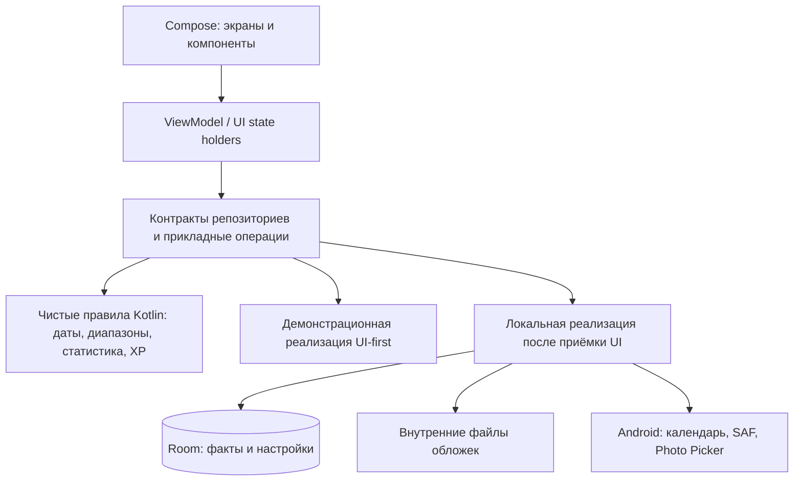
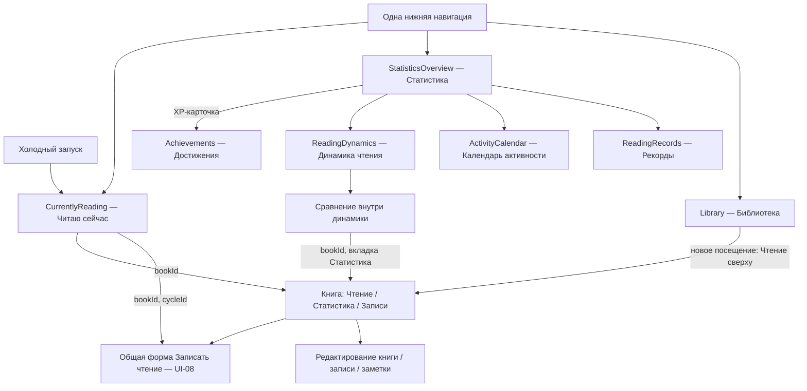
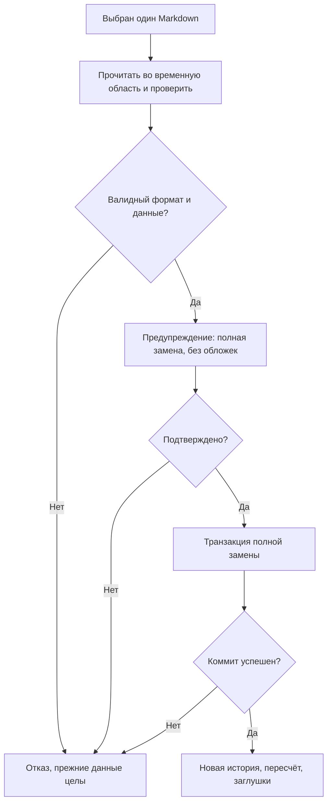

# ARCHITECTURE — Читательский дневник

Редакция 2.1 · REV-02 · 23 ноября 2026 г.

**Статус:** REV-02 **ACCEPTED** владельцем без замечаний 23 ноября 2026 г.; D01–D08/A01–A03 и документация согласованы. Отдельно разрешены статусный коммит в существующей ветке, Quick итогового Head, Ready и штатный merge только PR №5 после всех обязательных проверок. Факт MERGED и новый main SHA подтверждаются GitHub после операции. Новая структура в коде не реализована; UI-02/UI-03, изменение PR №2/№4 и следующая разработка не разрешены.

## 0. Применение

Требования — PRD, REV-01 и REV-02; точные визуальные токены — UI_DESIGN_SPEC. Архитектура определяет техническое обеспечение утверждённых правил, не вводит новые продуктовые решения. Историческая измерительная архитектура явно отменена, исходные решения сохранены в v2.04/ADR-04 и Git принятой базы.

## 1. Архитектурная стратегия

### 1.1. Цели и ограничения

- Один личный офлайн Android-клиент Kotlin + Jetpack Compose, без регистрации, серверов, синхронизации, встроенной читалки, телеметрии и обязательного интернета (SCOPE, NFR-01/07).
- Минимальная сложность инфраструктуры: один Gradle-модуль `:app` на старте, логические границы пакетов; не внедрять микросервисы, многомодульность ради модульности, event sourcing всей библиотеки, DI-фреймворк или внешние графические библиотеки без основания.
- Разделение UI от источников данных и расчётов; UI-first с теми же контрактами, которые позднее реализуют настоящие репозитории. Не строить полноценную БД или бизнес-логику в UI-фазе.
- Подтверждённые факты — источник истины, метрики — производные. Локальная надёжность и воспроизводимый пересчёт важнее преждевременной оптимизации.
- Не воссоздавать отменённые функции: секретные/периодические награды, пропущенные диапазоны, историю перерывов цикла, богатый редактор, таймер, измерение и ввод продолжительности, дополнительные графики, копирование обложек.

### 1.2. Слои и направление зависимостей (ADR-01, проект)

Это схема зависимостей/делегирования, не план параллельной реализации. `domain` не импортирует Compose, Room, Android Context; DTO хранения не передаются в composable. Репозитории и прикладной слой координируют транзакции; чистые калькуляторы не выполняют запись в БД. Android-зависимые адаптеры находятся в data/platform. Не создавать отдельный use case на каждый getter: выделять операции с реальными правилами (завершение, изменение истории, восстановление, пересчёт).

| Логический пакет | Ответственность | Когда появляется |
|---|---|---|
| `app` | Activity, корневая навигация, composition root | UI-01 |
| `ui.designsystem` | Тема, токены, компоненты, semantics, Preview | UI-01 |
| `ui.home` / будущие currently-reading/statistics UI, `ui.library` | Экранные модели и события, маршруты, composable; логические имена не требуют буквального переименования пакетов | UI-02 и UI-03 соответственно |
| `ui.book`, `ui.records`, `ui.achievements`, `ui.settings` | Остальные экранные контракты | Отдельные UI-задачи |
| `domain.model`, `domain.rules` | Значимые типы, инварианты, чистые расчёты | Минимум для UI-контрактов; полная логика после UI |
| `domain.port` / `application` | Репозитории, координация сложных команд и чтения снимков | Контракты постепенно; реализация после UI |
| `data.local`, `data.repository` | Room, DAO, маппинг, транзакции | Функциональная стадия |
| `platform.calendar`, `platform.files` | Android API и файловые адаптеры | Только по задачам функциональности; допустимо отдельное исследование осуществимости |
| `demo` / test fixtures | Синтетические состояния, временные взаимодействия | UI-first; не включать тестовые книги в реальную БД |

Composition root передаёт зависимости через конструкторы. На старте достаточно ручного DI (`AppContainer` или аналог). При росте проекта необходимость Hilt/дополнительных модулей обосновать ADR; не добавлять на всякий случай. Использовать coroutines, Flow и неизменяемые состояния, не создавать глобальные mutable singleton-списки книг.

## 2. Платформа и технический стек (ADR-02, проект)

| Область | Предлагаемый выбор | Ограничение |
|---|---|---|
| UI | Kotlin, Compose, Material 3 как техническая основа, собственная тема | Не копировать стандартные цвета/формы Material вместо согласованного дизайна |
| Навигация | Одна Activity, стабильная совместимая версия Jetpack Navigation для Compose | Поддержать все маршруты и правила возврата; версию подтвердить на UI-01 |
| Состояние | ViewModel, StateFlow, lifecycle-aware collection; SavedStateHandle для ограниченного UI-контекста | Не хранить книгу целиком, картинки, историю только в saved state |
| База | Room/SQLite, внешние ключи, миграции; KSP, если совместим | БД не создаётся на UI-01; никакого destructive fallback для пользовательских данных |
| Настройки | В той же Room БД для всех резервируемых и согласованных настроек | Не использовать отдельный DataStore как второй независимый источник важных данных |
| Время | `java.time` (Instant, LocalDate, YearMonth, ZoneId), Clock для календарной даты и технических отметок | Не использовать LocalDateTime как единственный абсолютный момент |
| Файлы | Photo Picker, внутреннее хранилище обложек, SAF для Markdown | Без broad storage permissions, без сетевых запросов |
| Сериализация | `kotlinx.serialization` либо эквивалентный строгий JSON codec для машинного блока внутри Markdown | Схема формата не совпадает со схемой Room; см. §10 |
| Тесты | JVM для чистых правил, Android instrumented для Room/Compose/системных сценариев, скриншоты | Версии и runners в TEST_PLAN/UI-01 |

**Фактический принятый стек UI-01:** minSdk 26, compile/target 37; версии и ограничения совместимости — ADR-10 и README. Runtime-матрица CI 26/35/36 сохранена. Room и формат копии ещё не реализованы; их будущие зависимости проверяются в отдельно разрешённых F-задачах. Не обновлять стек в REV-02 и не снижать target для обхода ограничений. Version catalog/Wrapper и локальное офлайн использование сохраняются.

## 3. Контракты UI и навигация — REV-02

Route собирает immutable UiState, stateless screen принимает данные/typed callbacks. UDF, ViewModel/StateFlow и lifecycle-aware collection сохраняются; composable не выполняет SQL/файлы/расчёты XP. Recomposition не повторяет команду. Пусто/готово/ошибка/подтверждение/ошибка поля различны; ноль не равен неизвестной истории. Ключи — стабильные ID.

### 3.1. Логический граф

Это логические названия и UI-контракты, не новая схема БД и не требование переименовать текущие Kotlin-классы. ReadingRecords здесь — страница четырёх рекордов, не хранилище ReadingRecord истории. Настройки остаются общим дочерним маршрутом по шестерёнке; существующие сведения/редакторы/карта/детали дня и столбца сохраняются. Дочерние направления не создают вторую нижнюю панель. Четвёртой корневой вкладки нет.

### 3.2. Ответственность и события

| Контракт | Данные и действия |
|---|---|
| CurrentlyReading | Только все активные книги, pin/ручной порядок закреплённых/последняя активность остальных, независимые bookmark/reachedMax/map, первая буква заглушки, typed RecordReading(bookId, cycleId) и прежние действия; точный подзаголовок ANALYTICS-02. Нет XP/аналитики |
| StatisticsOverview | Компактный глобальный XP, единая карточка pages/completedCycles/globalStreak, выбранный из шести период, PreviousPeriod/NextPeriod, typed переходы в четыре дочерних направления; без диаграмм/expandedSection |
| ReadingDynamics | Унаследованный применимый period, grouping День/Неделя/Месяц и interval; прежние столбцы и подробности; BookComparison всех активных/нулевых, список итогов завершений и BookStatistics(bookId, cycleId при наличии, returnContext) |
| ActivityCalendar | Полный год, выбранный year/прокрутка/день и детали по книгам; period обзора сохраняется для возврата, не отсекает год |
| ReadingRecords | Четыре рекорда и применимый period, all-time и selected результаты, охват/неизвестность |
| Achievements | Единый XP/уровень/звание, прежние четыре источника, встроенные 3×5/личные/награды/даты/история; плоские значки; прежние sheets/формы |
| Library | Все книги/4 статуса/теги, поиск/фильтры/сортировка/сетка-список/ручной порядок, первая буква заглушки; никаких новых папок/коллекций |
| Book / формы | Прежние bookId/visitId/cycleId, шапка и три вкладки, единая форма записи и карта, история/статистика книги, заметки/редактор/dirty state/ручное сохранение |
| Settings | Прежние тема/zone-lock/теги/Markdown export/restore; возврат к породившему маршруту |

### 3.3. Back и UI-state

- Холодный вход — CurrentlyReading. Обычный возврат из фона/поворот/блокировка/обычное пересоздание сохраняют текущий маршрут, выбранный период, текущие scroll anchors, grouping/interval/year, если этот UI уже реализован соответствующей задачей. Полный холодный запуск не обещает восстановление последнего маршрута.
- Смена трёх корневых вкладок сохраняет их ограниченный контекст. Back из StatisticsOverview/Library возвращает CurrentlyReading, как принятой UI-01 было Home; Back из первого пункта передаётся Android. Settings/редактор/sheet возвращают в источник, без искусственных дубликатов корневого маршрута.
- Back из Achievements/ReadingDynamics/ActivityCalendar/ReadingRecords возвращает StatisticsOverview с тем же периодом/прокруткой и осмысленным фокусом на породившем элементе. Если есть вложенные детали, сначала закрываются они. Контекст навигации не является новой статистической сущностью.
- Новый вход в книгу **из библиотеки** по NAV-08–11 — Чтение сверху/развёрнутая шапка. Явный переход «к статистике книги» из сравнения открывает её вкладку Статистика по bookId; Back возвращает динамику с тем же периодом/grouping/интервалом/scroll. Общая статистика и статистика книги не подменяют друг друга.
- Внутри посещения книги NAV-09–11 сохраняют независимые временные позиции трёх вкладок. Фон/поворот не завершают посещение, возврат из редактора сохраняет вкладку/якорь. Выход из книги завершает это посещение; старые позиции не переносятся в новое. Удалённые/заменённые ID после restore валидируются, недоступный маршрут безопасно закрывается.
- Один владелец выбранного периода в UI-контексте общей статистики; дочерние экранные состояния получают его/согласованное событие, не заводят конкурирующие копии. Глобальные XP/серия и сравниваемые страницы читаются из тех же проекций, не из отдельного баланса. Точная техника scope ViewModel/typed routes — будущая UI-задача, без нового фреймворка.
- SavedStateHandle хранит только ограниченный UI-контекст (ID/период/якорь), не историю/книги/изображения. Аккордеон/expandedSection больше не активный контракт. Резервируемые настройки темы/вида/сортировки/периода и порядок/pin сохранены; временные scroll/sheet/dirty-state не экспортируются. Судьба старого технического accordion preference при возможной будущей миграции — F-01/F-14, без потери фактов и без проектирования схемы сейчас.
- Доступность: выбранная корневая вкладка и дочерний заголовок объявляются осмысленно, закрытая книга имеет текстовую подпись, стрелки называют действие/период и доступное состояние границы. При возврате фокус не теряется. Масштаб/контраст/минимальные targets — UI_DESIGN_SPEC. Q01–Q03 не оправдывают обрезку, уменьшение шрифта или самовольную цикличность.

В UI-фазе только детерминированные demo-адаптеры. UI-02 реализует CurrentlyReading/StatisticsOverview и минимальные заглушки четырёх дочерних направлений, Library/Book/RecordReading, необходимые для проверки typed событий/Back. Полные аналитические страницы — UI-09, коллекция достижений — UI-12, библиотека — UI-03. Заглушки явно не сохраняют данные/не начисляют XP и не считаются готовыми соответствующими этапами.

## 4. Логическая модель и ограничения

Это концептуальная модель, **не физическая схема БД, DDL или реализация**. Room остаётся единственным источником фактов и резервируемых настроек. Точные таблицы/индексы/миграции — F-01. Не переименовывать сохранённые enum/поля без проверенной миграции.

| Сущность | Минимальное содержание и связи |
|---|---|
| Book | Устойчивый ID, название/автор/pageCount>0, библиография/формат, addedAt, локальный coverKey, независимый порядок/pin |
| Tag / BookTag | Нормализованное уникальное имя, связи многие-ко-многим; Unicode/кириллица, не только SQLite NOCASE |
| ReadingCycle | bookId, стабильный ordinal, статус, даты начала/конца DateValue, historical flag, bookmark/revision, reachedMax, начальная опора, оценка |
| ReadingRecord | ID, bookId/cycleId, точный LocalDate readingDate, исходный включительный rangeStart/rangeEnd, происхождение подтверждений и порядок сохранения, технические createdAt/updatedAt; при необходимости provenance изменения закладки |
| CompletionFact | Уникальный цикл, активность факта, фактическая дата/момент подтверждения А2; отдельно от редактируемой даты окончания |
| BookNote | bookId, NOTE/QUOTE, текст, необязательная страница, технические даты |
| CycleReview | cycleId, текст/технические даты; ≤1 отзыв и ≤1 оценка на цикл |
| CustomAchievement / CustomAward | Карточка/номинал 0–600 отдельно от минимального однократного факта actualXp/confirmedDate/revoked; удаление карточки не стирает законную награду |
| JournalSettings | zoneId/zoneLocked, тема, согласованные display/sort/period prefs; accordion не активен по §3.3 |

Отдельные ReadingSession TIMER/MANUAL, ActiveSegment, SessionDay, PageOnlyEvent и TimerDraft отменены, не включаются в будущую архитектуру или копию. Их историческое назначение — ADR-04 и спецификация v2.04; автоматическая конвертация измерений в страницы запрещена.

DateValue = DAY(LocalDate)/MONTH(YearMonth)/YEAR/UNKNOWN применяется к историческим датам цикла. Не кодировать месяц первым числом, год 1 января. **ReadingRecord всегда LocalDate с точным днём**, без будущего дня; приблизительные страницы до уточнения дня не создавать. Технический Instant не подменяет readingDate. DateValue сохраняет точность при сортировках/агрегации; неопределённый порядок не выдаётся за хронологию.

Один незавершённый цикл на книгу; стабильный ordinal не выводится из приблизительных дат. Отображаемый статус имеет один источник — текущий либо последний завершённый цикл; не вести две независимо редактируемые копии. Начальная закладка не даёт подтверждённых страниц. Все ссылки/границы 1…pageCount и bookmark 0…pageCount проверяются командами внутри транзакции, не только формой. Уникальность command ID, пары awardId/stage, единственного действующего завершения/личного получения защищена от гонок. Физический способ UNIQUE/FK/индексов не проектируется в REV-01.

## 5. Команды и транзакции

Единый application coordinator: предварительный расчёт последствий, явное подтверждение где требуется, повторная проверка версии и одна Room transaction для связанных изменений. UI не вызывает DAO. Стабильные ID команд и идемпотентность защищают повторное нажатие/повтор после commit. Файловая подготовка вне длительной транзакции. Подтверждение относится к ID/ревизии плана, не mutable DTO. Изменённый план требует новой проверки.

| Команда | Контракт |
|---|---|
| Add/EditBook | Метаданные/теги/цикл/начальная опора и закладка; диапазоны не выдумывать; обложка подготовлена до commit |
| MoveBookmark | Только позиция, допустимый рубеж/ревизия; не меняет опору чтения, карту, страницы или XP |
| SaveReadingRecord | Одна операция для CurrentlyReading, Book Reading и карты; READ-01–06, точная дата, один исходный диапазон, новые страницы, provenance и опциональная закладка атомарно |
| Edit/DeleteReadingRecord | Править выбранный факт и пересчитать все производные; не менять исходные диапазоны соседей; READ-05 защищает независимую закладку |
| ChangePageCount | Существующий согласованный мастер конфликтов LIB-22: все циклы/рубежи/диапазоны/страницы заметок, отмена либо адресные исправления, один commit; ни автоматической обрезки, ни автозавершения. Новую систему исправлений не добавлять |
| Defer/Resume/CreateReread | Один незавершённый цикл; старые данные сохраняются; новый цикл обнуляет свой учёт, а не историю книги |
| Complete/RevokeCompletion | Явное завершение, один факт А2; отмена/повторное завершение без двух незавершённых циклов и двух бонусов; последняя страница сама ничего не завершает |
| SaveNote/Quote/Review/Rating | Ручное сохранение, принадлежность/страница/≤1 отзыв и оценка цикла |
| Claim/RevokeCustomAward | Не более одной действующей выдачи; actualXp и фактическая дата; адресная отмена, повтор команды идемпотентен |
| DeleteCustomAchievement | Скрыть карточку, сохранить минимальное происхождение законного XP |
| DeleteBook | Подробное подтверждение и необязательная копия; атомарный каскад связанных фактов, независимые теги/личные награды целы; пересчёт |
| Restore | Весь проверенный снимок фактов/настроек одной транзакцией; ошибка — rollback; никаких частичных библиотек |

Чистый полный пересчёт затронутых проекций из одного снимка; только после измерения масштабирования допустим кеш с revision, сравнимый с полным оракулом. Ошибка вычисления не публикует противоречивый снимок. Нет независимого увеличиваемого balance или флагов карты.

## 6. Опора, исходные диапазоны и предотвращение двойного учёта

READ-02: начальная позиция книги — опора без подтверждения предшествующих страниц. При новой записи взять действительную опору **на момент сохранения**, независимо от выбранной прошлой даты; диапазон p+1…q сохраняется явно и никогда не выводится заново из календарных соседей. Перемещение закладки не меняет опору. Нижний диапазон карты не откатывает опору; подтверждения выше могут продвинуть её вперёд. Опора и reachedMax независимы: один только скачок закладки/рубежа не создаёт подтверждённой опоры выше начальной.

Для цикла C: U(C)=объединение всех действительных подтверждённых исходных диапазонов. pages(C)=|U(C)|. При добавлении R новые страницы = R минус U(C). При пустой разности не создавать самостоятельную запись повторного чтения. Частичное пересечение сохраняет исходный достоверный диапазон R; вычисляемый вклад может быть меньше его длины. Объединять отсортированные интервалы, не выделять массив размера книги. В новом цикле U пусто и те же номера учитываются заново.

Для календаря владелец страницы — первое **сохранённое**, всё ещё действительное подтверждение этой страницы в цикле, а не самая ранняя readingDate. Минимальная устойчивая последовательность подтверждений — технические данные целостности, сохраняемые в копии. При редактировании сохранять приоритет неизменившихся подтверждений; впервые добавленные участки получают новый порядок, не отбирают страницы задним числом у существующих владельцев. Равные технические моменты разрешать устойчивой последовательностью/ID, не выдумывать часы чтения. Это техническое обеспечение утверждённого правила первой сохранённой записи, не новый пользовательский редактор истории.

Пример владельца: сначала 12 ноября 121–150 (30), затем 10 ноября 111–130 (10 новых). Вклад 12 ноября остаётся 30, 10 ноября —10; union=40. Если первую запись удалить, оставшаяся подтверждает 111–130:20 страниц 10 ноября. Нельзя хранить только её первоначальные 111–120 и потерять 121–130. Если меняется только дата записи, её приоритет сохранения не меняется, её законный вклад следует новой точной дате. Любая правка пересчитывает из оставшихся фактов страницы/даты/XP/серии/ступени, не переписывает соседние диапазоны и не меняет закладку без READ-05. Удаление верхней записи не обрезает диапазон последующей: он уже сохранён явно.

## 7. Календарь и фиксированная зона

CAL-01/TZ-01: именованная зона телефона при первом запуске, дальше не синхронизируется автоматически. До первого конкретно датированного факта учёта предварительную зону можно изменить. Первая ReadingRecord, точнодатированный факт завершения или личной награды закрепляет zone/lock в той же транзакции. Простое создание книги/тега, техническая дата заметки и приблизительный исторический месяц/год сами не закрепляют. После удаления последнего факта lock остаётся; restore заменяет его вместе с зоной.

ReadingDate — гражданский LocalDate, не переводить его через Instant при смене зоны устройства. Сегодня и окна 7/30/90 включают календарные даты, не интервалы по 24 часа; год и группировки сохраняют прежнюю календарную семантику. Границы дня через начало даты и начало следующей даты в ZoneId, DST не равен обязательно 24 ч. Clock/ZoneProvider подменяются в тестах. Сохранять применённые календарные ключи; обновление tzdb не должно молча переносить историю. Если зона недоступна/данные несовместимы, сообщить, не назначать произвольную.

Технические createdAt/updatedAt/confirmedAt и даты/протяжённость жизненного цикла книги остаются допустимыми. Измерения чтения, активные секунды, дневная разбивка сеансов и округление минут отсутствуют.

## 8. Вычисляемые проекции

Закладка, reachedMax и U(C) независимы. Главный progress bar по reachedMax; при несовпадении позиции показываются оба значения. Карта: прочитано/не подтверждено; неподтверждённое не считается пропуском или прочитанным. Историческая полнота неизвестна, а 0 новых записанных страниц в точном периоде — достоверный ноль зарегистрированного вклада.

| Проекция | Правило |
|---|---|
| DailyActivity | Мощность множества страниц, владельцы которых имеют readingDate=d; записи сгруппированы по книгам, с циклом и исходным диапазоном |
| PeriodStats | Сумма дневных новых страниц и соответствующих записей; завершения по DateValue; текущая серия глобальна |
| Dynamics | Только страницы; день/неделя/месяц, навигация/детали прежние |
| Heatmap | 0 / 1–9 / 10–24 / 25–49 / 50+ страниц, те же пять цветовых уровней, годовая сетка/навигация/детали |
| ReadingStreak | Даты ≥1 новой страницы; строгая непрерывность; текущая до конца сегодня сохраняет вчерашнюю последовательность, полный пропущенный день прерывает; best — максимум за всю историю |
| BookComparison | Все «Читаю», включая нулевые, горизонтальные столбцы по страницам убывающе за применимый период |
| Records | Лучший день/месяц по страницам; самая длинная серия; книга с максимумом страниц; ровно четыре, прежние применимые периодные фильтры |
| Book/CycleStats | Тот же calculator с bookId/cycleId, все/один цикл; простой список итогов, неизвестные исторические значения явно |

Не вычислять скорость/прогноз, не добавлять радар, месячный календарь, сравнение с предыдущим периодом, настройку блоков или рейтинги. StatisticsOverview, три подробные страницы, история, книга и достижения читают согласованный снимок общих проекций. Их перемещение по REV-02 не меняет алгоритмы этой главы.

## 9. XP, уровни и достижения

XP_pages=сумма |U(C)| по циклам; 1 новая страница=1 XP. XP_completion=100×число законных активных CompletionFact, исключая исторические до дневника; дата А2 — фактическое подтверждение, не редактируемая дата окончания. XP_builtin=сумма законных ступеней; XP_custom=сумма actualXp неотменённых личных наград, включая удалённые карточки. totalXP — сумма четырёх источников; ни независимого баланса, ни `balance +=` при открытии/пересчёте. Календарный XP страниц следует владельцу READ-06, а не дате импорта.

### 9.2. Уровни и звания

C(n)=200+50×(n−1); T(L)=25×(L−1)×(L+6). Уровень — максимальный L≥1 с T(L)≤totalXP; остаток внутри уровня — totalXP−T(L). Использовать целочисленный безопасный поиск (или проверенное аналитическое приближение с проверкой границ), защищать переполнение, не округлять float на порогах. 0 XP → 1, 199 → 1, 200 → 2, 450 → 3, 1100 → 5, 3600 → 10, 12350 → 20, 26100 → 30. Звания: Искатель 1, Ученик 5, Исследователь 10, Хранитель знаний 20, Мудрец I 30, далее каждые 10 уровней. Степень k=1+floor((L−30)/10). Звание не начисляет XP; исправление истории может понизить уровень/звание. Отображение высоких степеней без переполнения и обрезания (визуальные правила уточнить в UI_DESIGN_SPEC).

### 9.3. Три пятиступенчатых достижения

| ID / название | I +25 | II +50 | III +100 | IV +150 | V +200 |
|---|---:|---:|---:|---:|---:|
| streak / Сила привычки | 3 дня | 7 дней | 14 дней | 30 дней | 100 дней |
| reading_pages / Страница за страницей | 100 | 1000 | 3000 | 10000 | 30000 страниц |
| completed_cycles / Путь читателя | 1 | 5 | 10 | 25 | 50 |

Streak использует лучшую историческую серию; pages — сумму подтверждённых новых страниц всех циклов; completed_cycles — действительные завершения, не исторические. Дата ступени — первая доказанная календарная дата достижения соответствующего порога, у завершений по А2. Пересчёт может отозвать недоказанную ступень/XP и изменить её дату. Обычный пропуск не отнимает best. Ключ catalogId+stage уникален; скачок через несколько порогов даёт каждую законную награду один раз. По 525 на направление, 1575 весь каталог. reading_time отменён, часы не конвертируются в страницы.

Собственные достижения: ручное однократное подтверждение, 0–600, actualXp не меняется при правке номинала; адресная отмена, сохранение законного факта удалённой карточки. Ненавязчивое сообщение о новом достижении, без повторных поздравлений при пересчёте/restore. Прежние числовой прогресс, полосы, bottom sheets и даты сохраняются; никаких новых игровых механик.

## 10. Markdown, обложки, восстановление и безопасность (Т4; SCOPE-04–06, NFR-02/07; ADR-08/09)

### 10.1. Хранение обложек

Photo Picker -> preview -> явное подтверждение. Копировать выбранный допустимый файл во внутреннее хранилище приложения под сгенерированным ключом, независимо от URI оригинала; проверить, что изображение декодируется, учитывать память, EXIF и размеры. Не перекодировать оригинал без необходимости, допустим кеш уменьшенного изображения для UI. Сначала подготовить новый файл и проверить его, затем атомарно заменить ссылку в БД; старый удалить только после успешного коммита при отсутствии ссылок. При сбое удалить лишь новые неприкреплённые файлы по безопасной процедуре, отложенная очистка сирот не удаляет действующие обложки. При удалении книги, замене базы и очистке кеша картинки не являются критичными для целостности БД. При отсутствующем файле — заглушка; восстановление У8 намеренно обнуляет все coverKey. Не экспортировать картинки, Base64, абсолютные пути, старые URI. Не копировать локальные обложки из прежней библиотеки в восстановленную даже при совпадении ID.

### 10.2. Один версионированный Markdown

Один UTF-8 .md без пароля/шифрования/ZIP/изображений. Читаемый текст и строго обозначенный машинный JSON-блок как прежнее архитектурное направление. Envelope reading-journal-backup: formatVersion, экспортный ID, createdAt, версия схемы, SHA-256 точных UTF-8 байтов payload. Контрольная сумма обнаруживает порчу, не удостоверяет подлинность. Версия формата независима от Room. Точный wire-format/кодирование/fixtures выбираются в F-13/F-14; здесь не создаётся физическая схема.

Сохранять исходные книги/циклы, ReadingRecord с точным readingDate и полным исходным диапазоном, начальную опору и минимальную последовательность/происхождение подтверждений READ-06, закладку/рубеж/ревизию, DateValue исторических завершений, факты А2/личных наград, заметки/цитаты/отзывы/оценки/теги/настройки/zone/lock. Не экспортировать только новые части диапазонов вместо исходных подтверждений. Производные страницы/серии/ступени/XP пересчитываются и при наличии кеша валидируются. Импорт не меняет дату чтения/награды или порядок первых подтверждений на дату импорта. Изображения, URI, технические кеши/временное UI исключены. Устаревшие модели таймера/сеансов не входят в новый формат. Старый формат принимается лишь с явно поддержанным, проверенным преобразованием без вымышленных страниц/дат; иначе безопасный отказ, не автоматическая конвертация минут.

### 10.3. Экспорт (ручной, SAF)

1. Получить согласованный снимок фактов в read transaction; сформировать и проверить временный файл внутри app storage (ограниченные ресурсы, без секретов в логах).
2. Предложить уникальное имя с датой и ID/суффиксом, вызвать системный выбор места нового документа (`ACTION_CREATE_DOCUMENT`, MIME Markdown/совместимый текстовый); не открывать старую копию для перезаписи. Уважать выбор локального или пользовательского доступного провайдера; приложение само не инициирует облачный экспорт.
3. Записать один файл, закрыть поток, проверить результат и при доступности повторно прочитать/проверить контрольную сумму. Не сообщать «успешно», если поток/провайдер завершился ошибкой или результат не подтверждён. При отмене/ошибке пытаться удалить только новый неполный документ в пределах предоставленных прав; если нельзя — предупредить об остатке. Никаких удалений прежних копий. SAF не гарантирует файловую транзакцию у любого провайдера, поэтому отделять staging и проверку; не обещать атомарность внешней записи.
4. Уведомить о результате и исключении обложек. Никаких периодических задач, автокопий, календарных подсказок, пароля. Не требовать отдельной папки/архива. Не запускать экспорт при открытии экрана. Необязательное действие перед опасным удалением книги сохранено.

### 10.4. Импорт (полная атомарная замена)

- `ACTION_OPEN_DOCUMENT` с одним файлом; сначала прочитать и проверить вне активной БД, ограничить размеры/глубину/количество объектов по обоснованным техническим ресурсам, не вводить произвольный продуктовый лимит. Строгая схема, версия, целостность, отсутствие дублирующих ID, ссылки, enum, числа, даты, диапазоны, один незавершённый цикл, точные даты ReadingRecord без будущего дня, корректное происхождение подтверждений, законные награды. Не исполнять Markdown, JS, SQL или произвольные пути из файла. Неподдерживаемую версию отклонить с объяснением; совместимые старые форматы только с проверенным преобразованием. Не исправлять значения молча.
- До изменения базы простое явное предупреждение о полной замене и отсутствии обложек, запрос подтверждения. Не делать подробный предпросмотр счётчиков, обязательную страховочную копию, слияние или частичный импорт. Отмена сохраняет текущую историю.
- Сериализовать изменения; после подтверждения проверить тот же проверенный снимок, не повторно читать изменяемый внешний файл. Одна Room transaction для всех резервируемых таблиц и настроек, включая зону/lock, факты наград и проверяемые проекции; не удалять файлы БД напрямую. Исключить старые обложки из новых ссылок; физически удалить прежние сиротские картинки только после успешного коммита. При ошибке rollback, прежние данные/настройки/обложки доступны. UI публикует новый снимок только после успеха. Не обещать отмену уже успешно совершённой полной замены.
- После commit убрать устаревшее UI-состояние/ссылки, не оставлять ссылки на прежнюю библиотеку. Пересчитать статистику и XP из фактов, даты факта награды не менять на импорт. Проверить восстановление при системной зоне, отличной от сохранённой. При сбое после commit согласованность БД не зависит от удаления сиротских файлов или доставки нотификации.

### 10.5. Приватность, миграции, логирование

Офлайн: не добавлять INTERNET и сетевые SDK без явного основания. Никаких аналитических сервисов, crash upload, содержимого заметок/цитат, имён книг, URI или персональной истории в логах/CI. Тестовые данные только синтетические. Файлы и БД в app-private storage. Android Auto Backup может автоматически участвовать в системном резервировании: для соблюдения решения «только вручную» явно отключить cloud backup, исключить пользовательские данные/обложки/настройки из cloud/device-transfer и применимых правил Android, проверить на целевом устройстве; не обещать универсальный запрет поведения OEM только одним `allowBackup=false`. Не шифровать пользовательский Markdown вопреки выбору владельца; рядом с экспортом информировать о доступности текста человеку с файлом. Настоящие копии не коммитить в GitHub.

Room: зафиксировать schema export в Git (без реальных данных), увеличивать schemaVersion при изменениях, явные миграции и migration tests. Не применять fallbackToDestructiveMigration. При ошибке открыть безопасное состояние с сообщением/возможностью корректного восстановления, не стирать библиотеку. Для backup format отдельная матрица читаемых версий и round-trip fixtures. Сохранять стабильные ID enum/награды независимо от локализованных названий. Не менять смысл ранее сохранённого поля без миграции. Параметры signing/applicationId определить до первой долговременной установки, не хранить ключи/пароли в Git; обновление APK должно сохранять данные при совместимых подписи и миграции. Debug и итоговые сборки — с явно обозначенным режимом данных; переход от demo к реальному не импортирует тестовые записи.

## 11. Этапы, отмена ADR и приёмка

Последовательность и scope — IMPLEMENTATION_PLAN. F-04 создаёт единые факты/карту/опору, F-05 подключает обе точки ввода и историю с общими командами; F-08 календарные проекции, F-09 сравнение/четыре рекорда/статистика, F-11/12 XP и достижения; F-13/14 копия/restore. F-06 и F-07 отменены без замены. Room/производные/экспорт не реализуются в UI-фазе или REV-01.

ADR-01/03/09 сохраняют архитектурные принципы; ADR-02 дополнен фактическим стеком ADR-10. ADR-04 отменён целиком и оставлен историческим. ADR-05/06/07/08 пересмотрены для новой модели; ADR-11 и CI policy/матрица 26/35/36 сохранены. Т1/Т6 и временная часть Т2 отменены; текущие риски: двойной учёт, неверная дата владельца пересечения, потеря исходного подтверждения при правке, нарушение атомарности/zone lock, подмена неизвестной истории нулём. Оракулы — TEST_PLAN REV-T01–27 и сохранённые проверки безопасности.

Трассируемость: READ/PAGE → §§4–6; CAL → §7; ANALYTICS/BOOKSTAT → §8; XP → §9; SCOPE/NFR → §§1–5, 10. D01/D03/D04/D12 → §§3–6; D02 → §§4, 7; D05–D08 → §9; D09–D11 → §§3, 8. Полный реестр происхождения — docs/decisions/REV-01-reading-without-timer.md.

REV-01 и его модели данных приняты 14 ноября; в REV-02 меняются только UI-контракты/маршруты/представление. Новый [ADR-12](docs/decisions/adr/ADR-12-rev02-navigation.md) фиксирует границы этого изменения; ADR-10/11 остаются историческими свидетельствами принятых каркаса/CI. Документационная редакция REV-02 ACCEPTED без замечаний 23 ноября; Ready/merge только PR №5 разрешены после проверок; Kotlin, ресурсы, Room-схема, manifest, зависимости и CI неизменны. Никакой ручной сборки APK/реализации/начала UI-02/UI-03. После разрешённого merge PR №5 проверить main/штатный CI и остановиться.
